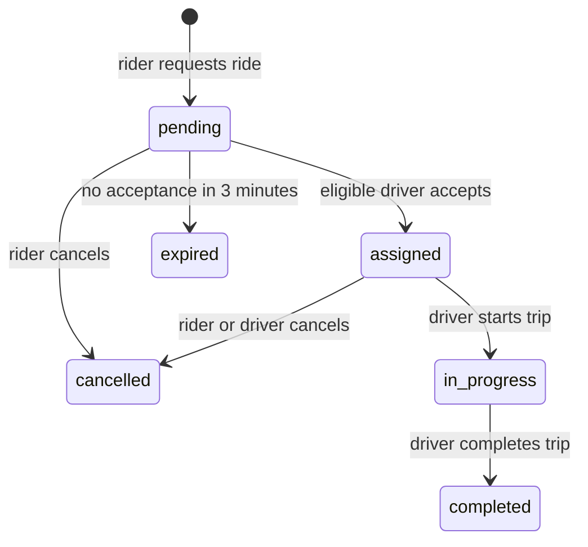

<div align="center">

# ZENIT

### Smart dispatch for the journeys around the corner.

[](https://zenit-live.onrender.com)
[](https://zenit-live.onrender.com/demo)
[](https://zenit-live.onrender.com/api/live/health)

**[Open the live pilot](https://zenit-live.onrender.com)** · **[Try the simulator](https://zenit-live.onrender.com/demo)** · **[View the API](https://zenit-live.onrender.com/docs)**

</div>


## What ZENIT does

ZENIT is a full-stack smart driver-dispatch project for bike and auto rides in Bengaluru. It includes a real multi-user pilot and an independent interactive simulator in the same FastAPI application.

| Live pilot `/` | Dispatch simulator `/demo` |
| --- | --- |
| Rider and driver accounts | Seeded Bengaluru driver fleet |
| Opt-in, fresh GPS sharing | Deterministic vehicle movement |
| Private, persistent ride history | Zero configuration or API keys |
| Geoapify search, routing, and map tiles | Matching and lifecycle walkthrough |
| Supabase PostgreSQL + Render | SQLite + atomic dispatch logic |

> The live pilot is designed for real-world testing. It does not process payments or promise background location tracking.

## Live deployment

| Service | Link | Purpose |
| --- | --- | --- |
| ZENIT live pilot | [zenit-live.onrender.com](https://zenit-live.onrender.com) | Real rider and driver experience |
| Simulator | [/demo](https://zenit-live.onrender.com/demo) | Explore dispatch without an account |
| Health check | [/api/live/health](https://zenit-live.onrender.com/api/live/health) | Database-backed service readiness |
| API docs | [/docs](https://zenit-live.onrender.com/docs) | Interactive FastAPI reference |

The production-style pilot runs on Render, persists live data in private Supabase PostgreSQL tables, and uses Geoapify for address lookup, route estimates, and map tiles. Render's free instance can take a short time to wake after inactivity.

## Highlights

**For riders**

- Search pickup and destination, tap the map, or enter coordinates.
- Select bike or auto and choose a 0.25–10 km driver radius.
- Follow pending, assigned, in-progress, completed, cancelled, and expired rides.

**For drivers**

- Create a vehicle profile and explicitly choose when to share GPS.
- Go online only with a recent position; stale GPS automatically takes a driver offline.
- View eligible nearby requests and accept, start, or complete a trip.

**For reliability and privacy**

- Category and distance checks run both when a ride is requested and accepted.
- PostgreSQL locks and partial unique indexes prevent duplicate active rides.
- Passwords use scrypt; browser sessions are HTTP-only and hashed at rest.
- Riders and drivers see only their own ride data. The Supabase Data API is disabled.

## Ride lifecycle



## Run locally

**Requirements:** Python 3.11+ and Node.js 18+ for the optional frontend test.

```bash
git clone https://github.com/vamshichethan/Zenit.git
cd Zenit
python3 -m venv .venv
source .venv/bin/activate
python -m pip install -r requirements.txt
uvicorn app.main:app --reload
```

Open [localhost:8000](http://127.0.0.1:8000) for the live interface or [localhost:8000/demo](http://127.0.0.1:8000/demo) for the simulator.

### Enable the live pilot locally

```bash
cp .env.example .env
# Set DATABASE_URL, GEOAPIFY_API_KEY, APP_BASE_URL, and COOKIE_SECURE in .env
set -a; source .env; set +a
uvicorn app.main:app --reload
```

Use Supabase's **Session pooler** URL for `DATABASE_URL`. Keep `.env` private; secrets never belong in GitHub.

## API overview

| Area | Main routes |
| --- | --- |
| Live authentication | `POST /api/live/auth/signup`, `login`, `logout`; `GET /me` |
| Driver operations | `PUT /api/live/driver/profile`, `POST /location`, `POST /availability` |
| Live rides | `POST /api/live/rides`, `POST /{id}/accept`, `start`, `complete`, `cancel` |
| Maps | `GET /api/live/geocode`, `GET /api/live/route` |
| Demo simulator | `/api/bookings`, `/api/drivers`, `/api/simulation/tick` |

Read the detailed [live API contract](docs/LIVE_CONTRACT.md) or use the hosted [interactive documentation](https://zenit-live.onrender.com/docs).

## Test it

```bash
python -m pytest -q
node --test tests/frontend.test.cjs
```

The suite covers matching, validation, state transitions, expiry, privacy, session authentication, GPS freshness, persistence, and concurrent acceptance. See the [test report](docs/TEST_REPORT.md) and [demo walkthrough](docs/DEMO.md).

## Stack

| Layer | Technology |
| --- | --- |
| Backend | FastAPI · SQLAlchemy · Pydantic |
| Database | Supabase PostgreSQL · SQLite for the standalone simulator |
| Maps | Geoapify · Leaflet |
| Hosting | Render · Docker |
| Quality | Pytest · Node test runner · GitHub Actions |

## Project structure

```text
app/                 FastAPI routes, dispatch domain, auth, PostgreSQL storage
static/              Live pilot, simulator, responsive UI, vendored Leaflet
tests/               Backend, live-pilot, frontend, and concurrency coverage
docs/                API contract, walkthrough, screenshots, and test report
.github/workflows/   Continuous integration
Dockerfile           Deployable container runtime
```

<div align="center">

Built for better connections, one ride at a time.

</div>
