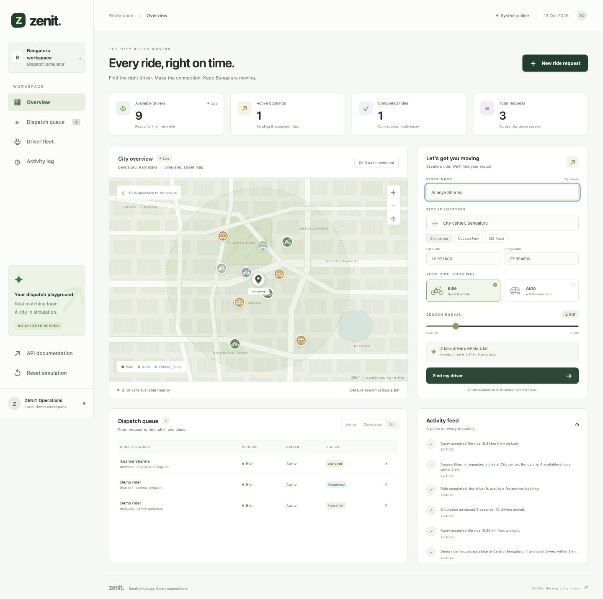

# ZENIT — Smart Driver Dispatch

ZENIT has two working experiences in one FastAPI app: `/` is a real rider/driver
pilot with accounts, opt-in GPS, live matching, and private Supabase PostgreSQL
storage. `/demo` is the original no-key dispatch simulator with a seeded
Bengaluru fleet and deterministic movement. The live pilot does not collect
payments and is designed for free-tier pilot use.

**Deployed pilot:** [https://zenit-live.onrender.com](https://zenit-live.onrender.com)



## Run locally

Requires Python 3.9 or newer; Python 3.11 is recommended and used in CI.

```bash
git clone https://github.com/vamshichethan/Zenit.git
cd Zenit
python3 -m venv .venv
source .venv/bin/activate
python -m pip install -r requirements.txt
uvicorn app.main:app --reload
```

Open [the live pilot](http://127.0.0.1:8000),
[the simulator](http://127.0.0.1:8000/demo),
[interactive API documentation](http://127.0.0.1:8000/docs), or
[the health check](http://127.0.0.1:8000/health).
On Windows, activate the environment with `.venv\Scripts\activate`.

The demo first start seeds twelve drivers near central Bengaluru: six bikes and six
autos, including one offline driver in each category. The default pickup is
`12.9716, 77.5946`; the default search radius is 2 km. The SQLite database is
`data/zenit.sqlite3`. Set `ZENIT_DB_PATH` to choose another location:

```bash
ZENIT_DB_PATH=/tmp/zenit-demo.sqlite3 uvicorn app.main:app --reload
```

## Try the complete flow

1. Choose a bike or auto, set a pickup on the map or enter its coordinates, and
   select **Find my driver**. City center, Cubbon Park, and MG Road presets are
   available. Matching drivers are ordered by distance.
2. In the **Driver inbox**, select **Accept ride** for an eligible driver. The booking becomes assigned and the driver
   becomes busy; additional acceptance attempts are rejected.
3. Cancel the ride to release its driver, or complete the assigned ride to mark
   it completed. Driver identity remains in the booking history.
4. Select **Start movement** to see driver positions change and inspect the
   event log. Unaccepted offers expire after 90 seconds.

Follow the [three-minute demonstration](docs/DEMO.md) for a submission walkthrough.
A command-line demonstration exercises the running API:

```bash
python scripts/demo.py
# Optional: restore the initial local demo data before demonstrating.
python scripts/demo.py --reset
```

The reset operation deletes demo bookings and restores the original driver
fleet. It is provided for repeatable demonstrations.

## Features and requirements

| Requirement | Implementation |
| --- | --- |
| Pickup coordinates and vehicle category | Validated booking form and `POST /api/bookings` |
| Nearby available drivers, initially 2 km | Configurable 0.25–10 km radius; haversine distance; nearest first |
| Correct vehicle category | Matching and acceptance both enforce bike/auto |
| One accepting driver per booking | Atomic SQLite transaction and guarded status transition |
| No double booking a driver | Busy status and a database uniqueness constraint on active assignments |
| Cancellation | Pending/assigned cancellation; assigned driver released in the same transaction |
| Updated driver and booking status | Dashboard state, booking history, API, and event log |
| Automated tests | Matching, validation, lifecycle, expiry, persistence, movement, and concurrent acceptance |
| Visual bonus | Distinct bike/auto markers, simulated movement, event log |

## Live pilot

The landing page supports rider and driver accounts with secure, HTTP-only
sessions. Passwords use scrypt hashes; the server stores only hashed session and
reset tokens. Live data uses an isolated `zenit` schema in Supabase PostgreSQL;
it is never exposed through Supabase's public Data API.

Drivers explicitly start location sharing before going online. A position is
fresh for 90 seconds and is sent only while the page is open. Riders can search
addresses and get driving estimates through Geoapify, or enter coordinates by
hand. An offer lasts three minutes. Only the rider and the accepted driver can
view a live ride.

### Configure locally

Copy `.env.example` to `.env` and supply a Supabase **Session pooler** URL,
Geoapify key, and local base URL. Session pooler is required for Render because
Supabase's direct database endpoint is IPv6-only while Render's free web
instances use IPv4 egress.

```bash
cp .env.example .env
set -a; source .env; set +a
uvicorn app.main:app --reload
```

Use `COOKIE_SECURE=false` locally and `true` on HTTPS hosting. The public
Geoapify browser key is returned only by `/api/live/config`; database and email
credentials are never returned by the API or committed to Git.

### Email recovery and Firebase

Firebase is optional. Its web configuration can support analytics or browser
notifications, but it does not send password-recovery email. Gmail SMTP can send
recovery messages using a Gmail App Password, though Render free instances block
outbound SMTP ports. For a deployed free pilot, configure Resend
(`RESEND_API_KEY` and `MAIL_FROM`) because it uses HTTPS. Sign-up and password
login work without an email provider.

## API

The backend uses FastAPI and publishes its OpenAPI schema at `/openapi.json`.
All API routes are prefixed with `/api`.

| Method | Route | Behavior |
| --- | --- | --- |
| `GET` | `/health` | Health status |
| `GET` | `/api/state` | Drivers, bookings, recent events, stats, and settings |
| `GET` | `/api/drivers` | Fleet; optional `vehicle_type` and `status` filters |
| `GET` | `/api/bookings` | Bookings, newest first |
| `GET` | `/api/bookings/{id}` | Booking details and current eligible drivers |
| `GET` | `/api/events` | Up to 100 latest events |
| `POST` | `/api/bookings` | Create a request; returns `201` |
| `POST` | `/api/bookings/{id}/accept` | Accept with `{"driver_id":"bike-01"}` |
| `POST` | `/api/bookings/{id}/cancel` | Cancel with an optional `reason` |
| `POST` | `/api/bookings/{id}/complete` | Complete an assigned ride |
| `PATCH` | `/api/drivers/{id}` | Change availability or coordinates |
| `POST` | `/api/simulation/tick` | Move the fleet by 1–60 simulated seconds |
| `POST` | `/api/demo/reset` | Restore demo data |

Example request:

```bash
curl -s -X POST http://127.0.0.1:8000/api/bookings \
  -H 'Content-Type: application/json' \
  -d '{"pickup_lat":12.9716,"pickup_lng":77.5946,"vehicle_type":"bike","radius_km":2,"rider_name":"Vamshi","pickup_label":"Central Bengaluru"}'
```

Use an eligible `driver_id` returned in that booking to accept it. Acceptance
rechecks current location, availability, vehicle type, and offer expiry.
Creating a request with no nearby candidates still returns a pending booking;
drivers that become available or move into range can accept before it expires.

Input errors return `422`, unknown IDs return `404`, and invalid transitions or
acceptance conflicts return `409`, with JSON `detail` errors. Coordinates must be
finite and within world limits. Busy drivers must be released by cancelling or
completing their ride before manual changes. Booking states are `pending`, `assigned`, `cancelled`,
`completed`, and `expired`.

```text
pending ── accept ──> assigned ── complete ──> completed
   │                     │
   ├── cancel ──> cancelled <── cancel ──┘
   └── 90 seconds ──> expired
```

## Tests and verification

```bash
python -m pytest -q
# Optional frontend concurrency regressions (Node.js 18+; no npm install needed)
node --test tests/frontend.test.cjs
```

The suite uses temporary SQLite files and an injected clock, so it does not
modify the demo database or wait in real time for offers to expire. Two race
tests use independent application instances, database connections, and
simultaneous requests: competing drivers for one booking, and competing bookings
for one driver. Each verifies one successful assignment and one `409` conflict.
The verification includes **57 Python tests and 6 JavaScript regression tests**.
Frontend tests cover delayed network responses, simulation/poll serialization,
mutation locking, and busy-driver controls. GitHub Actions runs both suites on
Python 3.11 and Node.js 22 for pushes and pull requests.

Executed results and visual checks are recorded in [the test report](docs/TEST_REPORT.md).

## Docker

```bash
docker build -t zenit .
docker run --rm -p 8000:8000 -v zenit-data:/app/data zenit
```

The image runs as a non-root user and includes an HTTP health check. The named
volume preserves the database across container restarts. Use the local Python
quickstart if Docker is unavailable.

## Design and limits

- **SQLite transactions:** acceptance reserves the booking and driver together.
  `BEGIN IMMEDIATE` serializes writers; a partial unique index protects active
  driver assignments even across separate application instances.
- **Fresh matching:** candidates are computed from current availability and
  haversine distance. Eligible lists are advisory; acceptance validates again.
- **Expiry:** offers expire on API access after 90 seconds of wall-clock time.
  The dashboard polling exposes expiry while it is open. Movement ticks advance
  positions; they do not advance the offer clock.
- **Persistent history:** cancelled/completed bookings preserve their assigned
  driver's identity. Only an assigned booking holds a driver reservation.
- **Offline map:** the street-map illustration and markers work without map
  providers or API keys. This is a Bengaluru dispatch simulation; it does not
  provide live traffic, road routing, GPS, payments, or notifications.
- **Demo scope:** the prototype has no authentication or user isolation. Run it
  locally or on a trusted demo network. The reset endpoint is intentionally
  available for repeated demonstrations. A production system would add access
  control, a background expiry worker, monitoring, and a scalable database.

```text
app/                   FastAPI routes, SQLite store, matching and movement
static/                Dashboard, styling, JavaScript, offline map
tests/                 Automated behavior and concurrency tests
scripts/demo.py        Repeatable API walkthrough
docs/                  Demo guide, screenshot, API contract, test report
.github/workflows/     Continuous integration
Dockerfile             Portable local runtime
```
